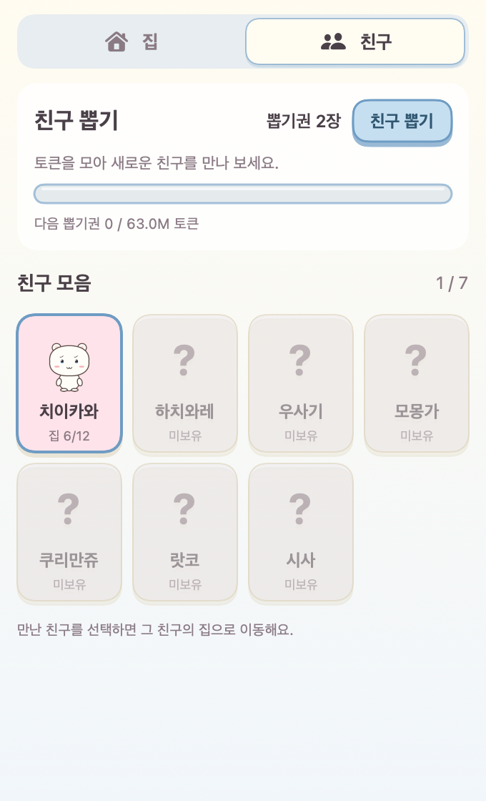

# ChiiBar

<p align="center">
  
</p>

Claude Code와 Codex를 쓰는 동안, 메뉴 막대 속 친구의 집이 자라는 macOS 팬 앱입니다.
경험치는 자동으로 쌓이고, 업그레이드 버튼을 누르면 친구가 집을 뚝딱뚝딱 꾸밉니다.

**[최신 버전 다운로드](https://github.com/kitesik/ChiiBar/releases/latest)**

## 설치

### Homebrew로 한 줄 설치

[Homebrew](https://brew.sh)가 설치되어 있다면 아래 명령만 실행하세요.

```bash
brew install --cask kitesik/tap/chiibar
```

설치 후 응용 프로그램에서 ChiiBar를 실행합니다. 첫 실행이 차단될 때는 아래 안내를 참고하세요.
업데이트는 `brew update && brew upgrade --cask kitesik/tap/chiibar`로 진행합니다.
기존에 직접 설치한 앱이 같은 경로에 있으면 먼저 종료한 뒤 앱 파일만 휴지통으로 옮기고 설치하세요.
게임 저장 폴더를 지우지 않으면 친구와 집 진행 상황은 유지됩니다.

### 직접 다운로드로 설치

macOS 14 Sonoma 이상이 필요합니다. 배포 파일은 Apple Silicon과 Intel Mac 공용입니다.

1. 위 링크에서 `ChiiBar-0.2.1-universal.zip`을 다운로드합니다.
2. 압축을 풀고 `ChiiBar.app`을 응용 프로그램 폴더로 옮깁니다.
3. 앱을 실행하고 화면 상단 메뉴 막대의 작은 캐릭터 아이콘을 누릅니다.
4. 친구 탭에서 무료 첫 뽑기로 친구를 만나세요.

현재 개인 배포판은 Apple Developer ID 서명과 공증을 받지 않았습니다.
첫 실행이 차단되면 실행을 한 번 시도한 뒤 **시스템 설정 → 개인정보 보호 및 보안 → 그래도 열기**에서 ChiiBar를 허용할 수 있습니다.
[Apple의 첫 실행 안내](https://support.apple.com/102445)를 참고하세요.
보안 설정 전체를 끄거나 터미널 명령을 실행할 필요는 없습니다.

업데이트할 때는 메뉴 막대 아이콘을 우클릭해 종료한 뒤 새 앱으로 교체하세요.
친구와 집 진행 상황은 유지됩니다. 자동 업데이트와 로그인 시 자동 실행 기능은 없습니다.

## 어떤 앱인가요?

- **집:** 경험치를 모아 클릭으로 12단계 집을 업그레이드합니다. 남은 경험치는 건설 후 0%부터 차오르며 다음 단계로 이어집니다. 진행 바와 정보 아이콘에 마우스를 올리면 이유를 확인할 수 있습니다.
- **친구:** 아노코와 카니를 포함한 9명의 친구를 만납니다. 첫 뽑기는 무료입니다.
- **오늘의 대시보드:** 오늘 업그레이드 횟수와 하루 경험치 목표 달성률을 보여줍니다.
- **하루 목표:** 4,200만 경험치입니다. 100% 이후에도 경험치는 계속 쌓입니다.
- **뽑기권:** 유효 토큰 6,300만마다 한 장을 얻습니다.

집 업그레이드 비용은 150만부터 8,400만까지 점점 증가합니다.
목표와 비용은 현재 고정값이며 사용량에 따라 걸리는 시간은 달라집니다.
중복 친구를 만나면 해당 친구에게 다음 업그레이드 분량의 경험치를 줍니다.
완성된 집의 친구가 중복되면 뽑기권을 돌려줍니다.




화면 속 수치는 미리보기용 예시입니다. UI는 한국어로 제공됩니다.

## 데이터와 개인정보

별도 로그인이나 API 키가 필요하지 않습니다. 앱 자체는 네트워크 전송이나 분석 서비스를 사용하지 않습니다.
이 Mac에 있는 Claude Code와 Codex의 사용 로그를 약 30초마다 읽습니다.

- Claude Code: `~/.claude/projects/**/*.jsonl`
- Codex: `~/.codex/sessions/**/*.jsonl`
- 게임 저장: `~/Library/Application Support/ChiiBar/state.json`

프롬프트와 응답 본문을 별도로 저장하거나 전송하지 않습니다.
저장 파일에는 친구와 집 진행 상태, 일별 사용량, 로그 파일 경로와 읽기 위치 등이 포함됩니다.
로그가 없으면 첫 친구는 만날 수 있지만 새 경험치는 쌓이지 않습니다.
비표준 로그 경로 지정은 현재 지원하지 않습니다.

캐시 토큰은 10%로 환산합니다. Claude는 입력 + 출력 + 캐시 생성 + 캐시 읽기/10,
Codex는 비캐시 입력 + 캐시 입력/10 + 출력의 누적값 차이를 계산합니다.
앱의 경험치는 각 서비스의 과금 수치와 같지 않습니다.

## 소스에서 빌드

Swift 6 이상과 macOS Command Line Tools 또는 Xcode가 필요합니다.

```bash
git clone https://github.com/kitesik/ChiiBar.git
cd ChiiBar
bash Scripts/check.sh
bash Scripts/build-app.sh
```

생성된 `build/ChiiBar.app`을 응용 프로그램 폴더로 옮겨 실행합니다.
공용 바이너리는 `CHIIBAR_UNIVERSAL=1 bash Scripts/build-app.sh`로 빌드합니다.
미리보기는 `bash Scripts/render.sh`로 만들 수 있습니다.

## 팬 프로젝트 안내

ChiiBar는 비공식, 비상업 팬 프로젝트이며 원작 권리자와 관계가 없습니다.
치이카와 캐릭터의 권리는 원 권리자에게 있습니다.
앱의 캐릭터 이미지는 이 프로젝트의 벡터 그림에서 제작했으며 공식 이미지나 애니메이션 프레임을 포함하지 않습니다.
