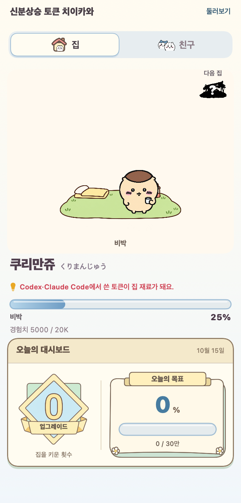
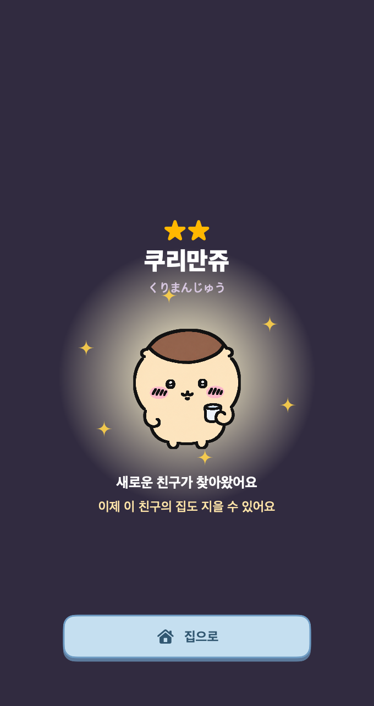
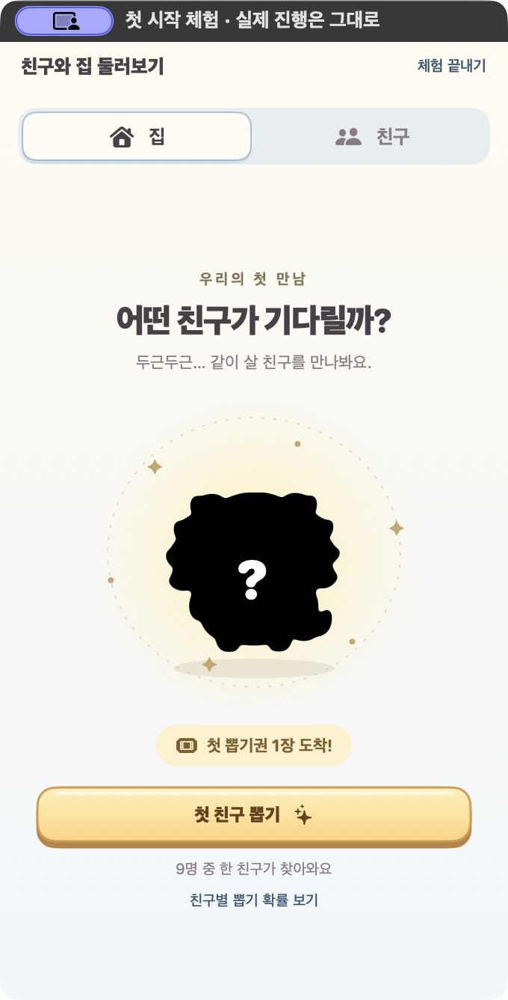
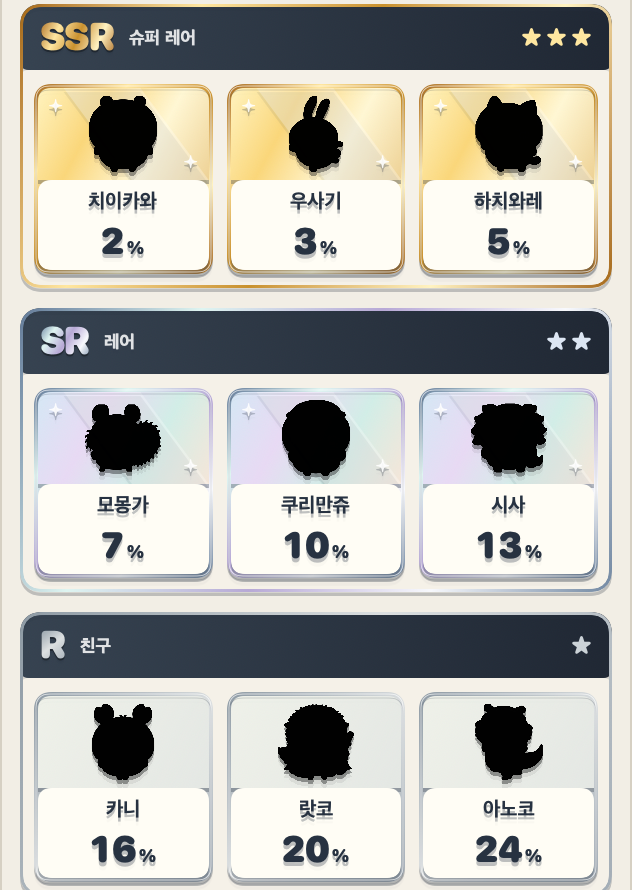
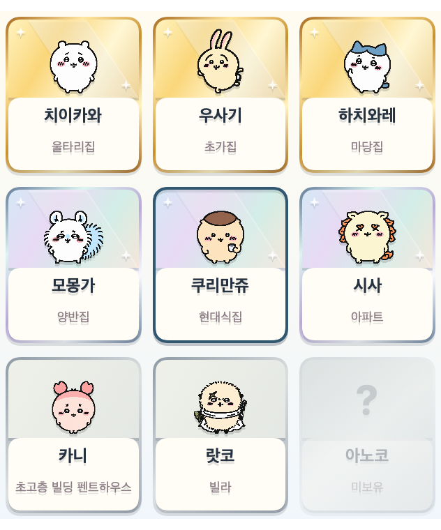
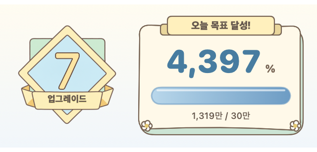

# 신분상승 토큰 치이카와

Claude Code와 Codex를 쓰는 동안, 치이카와 친구가 토큰을 먹고 비박부터 초고층 빌딩 펜트하우스까지 집을 지어 가는 macOS 팬 앱입니다.
토큰이 쌓여 게이지가 가득 차면 업그레이드 버튼을 눌러 한 단계씩 이사합니다. 남은 경험치는 새 집에서 이어 채워집니다.

**v0.4.20 — 130% 커진 집과 친구, 한눈에 읽히는 오늘의 대시보드.**

현재 집과 친구를 이전보다 130% 크게 표시합니다. 오늘의 대시보드는 제목·날짜 헤더, 업그레이드 횟수와 목표 달성률의 두 영역, 갈색 외곽선으로 묶었습니다. 업그레이드 버튼이 나타나도 하단이 잘리지 않도록 창 높이를 조정했습니다.

비와 눈은 실제 날씨와 관계없는 게임 연출입니다. 20분 주기 중 비는 75초, 눈은 90초 동안 내리고 앞뒤 6초에 걸쳐 부드럽게 바뀝니다. 벽돌집부터는 비를 피하며 친구마다 눈에 폴짝거리거나 추위를 타는 반응이 다릅니다. 표정은 기존 검토된 그림을 사용합니다. 원작의 특정 장면을 재현했다는 뜻은 아닙니다. 햇볕 효과는 없고, 움직임 줄이기 설정에서는 눈·비와 반응 동작이 정지합니다.

업그레이드 배지에는 반듯한 그림 숫자를 사용합니다. 오늘의 목표는 파란색의 굵은 일반 숫자와 더 두꺼운 게이지로 표시하며, 천 단위 쉼표를 유지합니다.
별도 가입이나 API 키 없이, Mac에 남는 Codex·Claude Code 사용 기록으로 자랍니다. 앱 자체는 무료이며 AI 서비스 이용료는 별도입니다.

**[최신 버전 다운로드](https://github.com/kitesik/ChiiBar/releases/latest)**

## 설치

### Homebrew로 한 줄 설치

[Homebrew](https://brew.sh)가 설치되어 있다면 아래 명령만 실행하세요.

```bash
brew install --cask kitesik/tap/chiibar
```

설치 후 응용 프로그램에서 ChiiBar를 실행합니다. 첫 실행이 차단될 때는 아래 안내를 참고하세요.
업데이트는 `brew update && brew upgrade --cask kitesik/tap/chiibar`로 진행합니다.
기존에 직접 설치한 앱이 같은 경로에 있으면 먼저 종료한 뒤 앱 파일만 휴지통으로 옮기고 설치하세요.
게임 저장 폴더를 지우지 않으면 친구와 집 진행 상황은 유지됩니다.

### 직접 다운로드로 설치

macOS 14 Sonoma 이상이 필요합니다. 배포 파일은 Apple Silicon과 Intel Mac 공용입니다.

1. 위 링크에서 `ChiiBar-0.4.20-universal.zip`을 다운로드합니다.
2. 압축을 풀고 `ChiiBar.app`을 응용 프로그램 폴더로 옮깁니다.
3. 앱을 실행하고 화면 상단 메뉴 막대의 작은 캐릭터 아이콘을 누릅니다.
4. 첫 화면에서 **첫 친구 뽑기**를 누르세요. 무료 뽑기권 1장으로 전체 9명 중 한 친구를 만납니다.

현재 배포판은 Apple Developer ID 서명과 공증이 없어 다른 Mac의 Gatekeeper에서 실행이 차단될 수 있습니다. **0.4.16도 아직 공증된 배포본이 아닙니다.** 정식 서명·공증 절차는 준비했지만 배포 인증서가 없어 완료하지 못한 상태입니다. 친구에게 보안 경고 없는 설치를 제공하려면 공증 완료 버전이 필요합니다.

배포 준비 및 검증 절차는 [정식 서명·공증 안내](docs/notarization.md)에 있습니다. 보안 설정을 끄거나 격리 속성을 지우는 방식은 배포 절차에 포함하지 않습니다.

업데이트할 때는 메뉴 막대 아이콘을 우클릭해 종료한 뒤 새 앱으로 교체하세요.
친구와 집 진행 상황은 유지됩니다. 자동 업데이트와 로그인 시 자동 실행 기능은 없습니다.

## 직접 체험하기

메뉴 막대 아이콘을 누르고 오른쪽 위 **둘러보기**를 선택하세요. **다음 친구**, **경험치 받기**, **쓰다듬기**로 9명과 13단계 집을 바로 체험할 수 있습니다. 체험 상태는 저장하지 않으며 실제 친구·토큰 기록과 분리됩니다. **체험 끝내기**로 실제 진행 화면으로 돌아옵니다.

## 어떤 앱인가요?

- **집:** 토큰으로 경험치를 쌓고, 업그레이드 버튼 한 번에 한 단계씩 집을 짓습니다. 남은 경험치는 다음 집으로 이어집니다.
- **주거 순서:** 비박 → 움막집 → 벽돌집 → 굴뚝집 → 울타리집 → 마당집 → 초가집 → 양반집 → 현대식집 → 빌라 → 아파트 → 초고층 빌딩 → 초고층 빌딩 펜트하우스.
- **건설 장면:** 업그레이드를 누르면 새 집이 지어지고 축하 연출이 이어집니다. 남은 경험치는 새 게이지에 채워집니다.
- **캐릭터:** 9명의 친구가 집 안팎에서 쉬거나 움직입니다. 랏코·시사처럼 작게 보이던 친구는 크기와 선을 보강했습니다.
- **친구:** 아노코와 카니를 포함한 9명의 친구를 만납니다. 첫 뽑기는 무료입니다.
- **오늘의 대시보드:** 오늘 업그레이드 횟수와 하루 경험치 목표 달성률을 보여줍니다.
- **하루 목표:** 30만 경험치입니다. 100% 이후에도 경험치는 계속 쌓입니다.
- **뽑기권:** 경험치 50만마다 한 장을 얻습니다.

뽑기 확률은 치이카와 2%, 우사기 3%, 하치와레 5%, 모몽가 7%, 쿠리만쥬 10%, 시사 13%, 카니 16%, 랏코 20%, 아노코 24%입니다. 첫 무료 뽑기도 같습니다. 대표 캐릭터인 치이카와를 가장 희소하게 만나도록 정한 게임 내 확률이며 인기 투표 수치가 아닙니다.

집 업그레이드 비용은 2만부터 350만까지 점점 증가합니다. 비박부터 펜트하우스까지 누적 1,154만입니다.
목표와 비용은 현재 고정값이며 사용량에 따라 걸리는 시간은 달라집니다.
중복 친구를 만나면 해당 친구의 집에 다음 단계 비용의 10%(최대 15만)만큼 경험치가 더해집니다. 업그레이드는 직접 눌러 진행합니다.
완성된 집의 친구가 중복되면 뽑기권을 돌려줍니다.









[숫자 스탬프 전체 미리보기](docs/number-stamps.png) · [이미지 원본과 제작 프롬프트](Art/StampNumbers/README.md)

화면 속 수치는 미리보기용 예시입니다. UI는 한국어로 제공됩니다.

### 기존 사용자 업데이트

친구·집 단계·보유 뽑기권은 유지합니다. 0.4.14에서는 이미 모은 집 경험치를 유지하고, 진행 중인 뽑기권 게이지는 같은 비율로 환산합니다. 새로운 사용량부터 하루별 경험치 환산을 적용합니다. 0.4.0에서 비용이 낮아져 진행 중인 집과 뽑기권 게이지는 **기존 달성 비율과 초과분**을 새 기준으로 환산합니다. 예를 들어 50%는 50%, 150%는 150%로 이어지며 정수 처리에서 1토큰 미만 차이는 생길 수 있습니다. 자동 업그레이드는 하지 않습니다.

처음 옮길 때 저장 폴더에 `state.before-economy-v3-…json` 원본 백업을 남깁니다. 이미 새 기준으로 저장한 데이터는 다시 환산하지 않습니다. 일별 실제 사용량과 이미 얻은 뽑기권은 유지합니다.

## 데이터와 개인정보

별도 로그인이나 API 키가 필요하지 않습니다. 앱 자체는 네트워크 전송이나 분석 서비스를 사용하지 않습니다.
이 Mac에 있는 Claude Code와 Codex의 사용 로그를 약 30초마다 읽습니다.

- Claude Code: `~/.claude/projects/**/*.jsonl`
- Codex: `~/.codex/sessions/**/*.jsonl`
- 게임 저장: `~/Library/Application Support/ChiiBar/state.json`

프롬프트와 응답 본문을 별도로 저장하거나 전송하지 않습니다.
저장 파일에는 친구와 집 진행 상태, 일별 사용량, 로그 파일 경로와 읽기 위치 등이 포함됩니다.
로그가 없으면 첫 친구는 만날 수 있지만 새 경험치는 쌓이지 않습니다.
비표준 로그 경로 지정은 현재 지원하지 않습니다.

캐시 토큰은 10%로 환산합니다. Claude는 입력 + 출력 + 캐시 생성 + 캐시 읽기/10,
Codex는 비캐시 입력 + 캐시 입력/10 + 출력의 누적값 차이를 계산합니다.
유효 토큰의 일일 첫 25만은 경험치 100%, 25만~100만 구간의 추가분은 20%, 100만 초과 추가분은 1%로 쌓입니다. 날짜별 누적 차이로 계산하므로 분할 집계·앱 재시작으로 보상이 달라지지 않습니다. 예: 하루 25만 → 25만 경험치, 100만 → 40만, 1,700만 → 56만. 일반 문서·기획 작업의 진행은 유지하고 장시간 사용 시 보상 과잉을 줄이는 초기 조정값입니다.

앱의 경험치는 각 서비스의 과금 수치와 같지 않습니다.

## 소스에서 빌드

Swift 6 이상과 macOS Command Line Tools 또는 Xcode가 필요합니다.

```bash
git clone https://github.com/kitesik/ChiiBar.git
cd ChiiBar
bash Scripts/check.sh
bash Scripts/build-app.sh
```

생성된 `build/ChiiBar.app`을 응용 프로그램 폴더로 옮겨 실행합니다.
공용 바이너리는 `CHIIBAR_UNIVERSAL=1 bash Scripts/build-app.sh`로 빌드합니다.
미리보기는 `bash Scripts/render.sh`로 만들 수 있습니다.

## 팬 프로젝트 안내

ChiiBar는 비공식, 비상업 팬 프로젝트이며 원작 권리자와 관계가 없습니다.
치이카와 캐릭터의 권리는 원 권리자에게 있습니다.
캐릭터 이미지는 작가의 공개 만화를 참고해 AI 도구로 재제작했습니다. 공식 만화 페이지나 애니메이션 프레임 자체를 앱에 포함하지 않습니다. [그림과 참고 자료](Art/Sprites/Manga/README.md)를 확인할 수 있습니다. 비공식·무료 표시는 권리자의 이용 허락을 뜻하지 않습니다.

## 최근 변경

- **0.4.16:** 그림 숫자에 천 단위 쉼표를 추가했습니다. 색상은 유지합니다. 정식 서명·공증 절차를 추가했으나 현재 배포본은 아직 미공증입니다.
- **0.4.15:** 현재 집을 중앙 정렬하고 다음 집을 위쪽에 분리했습니다. 목표 달성률에도 그림 숫자를 적용하고, 확률표·친구 모음을 일반→레어→슈퍼 레어 순으로 정렬했습니다.
- **0.4.14:** 현재 집과 다음 집을 분리하고, 탭·상단바에 친구 얼굴을 적용했습니다. 오늘 목표를 손그림 퀘스트 카드로 바꾸고, 하루 과도한 사용량의 보상을 완만하게 조정했습니다.
- **0.4.13:** 업그레이드 배지를 부드러운 손그림 선과 크림·하늘색·민트 배색으로 조정했습니다.
- **0.4.12:** 업그레이드 횟수를 금빛 다이아몬드 배지 중앙에 표시하고, 아래 리본에 업그레이드 이름을 넣었습니다.
- **0.4.11:** 업그레이드 횟수 0~30을 각각 제작한 숫자 일러스트로 표시합니다. 31 이상도 같은 이미지 숫자를 조합합니다.

- **0.4.10:** 스탬프 장식과 숫자 효과를 줄이고 치이카와·작은 집 장식, 차분한 인쇄풍 타이포로 정리했습니다.

- **0.4.9:** 오늘의 업그레이드 배지를 세 친구가 장식하는 스탬프로 바꾸고 숫자·문구를 입체적으로 다듬었습니다. 목표 달성률의 % 기호는 작게 분리했습니다.

- **0.4.8:** 친구 모음에도 확률표와 동일한 등급별 배경·테두리를 적용했습니다. R 명칭을 일반으로 바꿨으며 집 그림 없이 현재 집 이름만 표시합니다.

- 집·친구 탭과 업그레이드·집으로 버튼에 둥근 게임풍 아이콘을 적용했습니다.

- **0.4.7:** 치이카와를 최저 확률 2%·SSR로 조정하고, 업그레이드 버튼의 집 아이콘 뒤 흰 원형 배경을 제거했습니다.

- **0.4.6:** 한글 이름 바로 오른쪽에 일본어를 배치했습니다. 이름 아래 다음 집 명칭 안내를 제거하고 오른쪽 위 물음표 미리보기만 남겼습니다.

- **0.4.5:** 홈과 친구 목록에서 집 단계 숫자를 숨겼습니다. 친구 이름 아래에는 현재 집의 명칭만 표시합니다.

- **0.4.4:** 일본어 이름을 한글 바로 왼쪽에 배치하고, 다음 집 안내와 집 이름의 글꼴·크기를 통일했습니다. 집 이름 색은 차분한 자주빛으로 조정했습니다.

- **0.4.3:** 뽑기를 앱 전체 화면으로 확대하고 대기 버튼을 제거했습니다. 캐릭터 한글 이름을 굵게 다듬고 일본어 이름을 함께 표시하며 다음 집 이름은 청록색으로 구분합니다.

- **0.4.2:** 대시보드의 “오늘도 한 뼘 성장!” 등 부가 문구를 없애고 설치·업데이트 안내를 정리했습니다.
- **0.4.1:** 랏코·시사의 크기와 몸·눈·입 선을 보강하고, 모몽가·아노코도 작은 화면에서 더 잘 보이게 조정했습니다.
- **0.4.0:** 성장 비용을 낮추고 기존 진행률을 보존하는 저장 이관을 추가했습니다. 첫 무료 뽑기, 변형 실루엣과 친구별 확률표를 포함합니다.

전체 변경과 배포 파일은 [릴리스](https://github.com/kitesik/ChiiBar/releases)에서 확인하세요.
집 그림과 구성 기준은 [Art/Homes](Art/Homes/README.md)에 있습니다.

## 문제 제보

[GitHub Issues](https://github.com/kitesik/ChiiBar/issues)에 앱 버전·macOS 버전·증상과 재현 방법을 알려주세요. 개인 대화나 사용 로그 원본은 올리지 마세요.
메뉴 막대 아이콘이 안 보이면 ChiiBar가 실행 중인지 확인하고, 노치나 다른 메뉴 아이콘에 가려져 있지 않은지 확인해 주세요.

배포본은 Apple Silicon에서 실행 확인했습니다. Intel 바이너리도 포함하지만 Intel 실기기 검증은 아직 하지 못했습니다.
